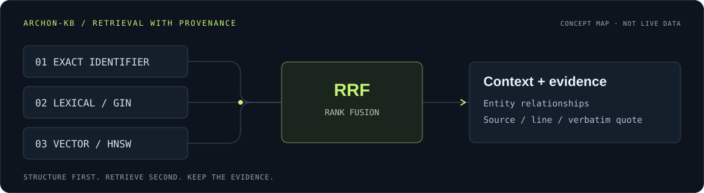

<picture>
  <source media="(max-width: 600px)" srcset="assets/hero-compact.svg">
  
</picture>

  <a href="#selected-work"><strong>Selected work</strong></a> &nbsp; / &nbsp;
  <a href="#engineering-stack"><strong>Engineering stack</strong></a> &nbsp; / &nbsp;
  <a href="#field-notes"><strong>Field notes</strong></a> &nbsp; / &nbsp;
  <a href="#connect"><strong>Connect ↗</strong></a>

# Denys Stadnik

**Software engineer · Cybersecurity student · DeFexGG**

I build across abstraction layers: **Windows kernel research, driver-aware desktop software, technical search infrastructure, and interactive web experiences.** Studying Cybersecurity at **Khmelnytskyi National University**.

The common thread: understanding what happens beneath the interface—and making that complexity useful above it.

  
  
  
  
  

## Selected work

01 / SYSTEMS → 02 / TELEMETRY → 03 / RETRIEVAL → 04 / EXPERIENCE → 05 / MOTION

### 01 &nbsp; Drivers Portfolio

**Understand the machine beneath the application.**

A Windows kernel engineering research suite spanning driver communication, memory management, PE loading, and user-mode tooling. The repository includes kernel C sources, a C++ loader, and a manual mapper.

`C` `C++` `WDK / MSVC` `Windows internals`

**[Explore the repository ↗](https://github.com/DeFexNN/drivers-portfolio)** &nbsp; · &nbsp; [Kernel source](https://github.com/DeFexNN/drivers-portfolio/tree/main/MidnightSoftwareDriver/MidnightSoftwareDriver) &nbsp; · &nbsp; [PE mapper](https://github.com/DeFexNN/drivers-portfolio/blob/main/driver_manual_mapper/mapper.cpp)

<strong>Companion research → Kernel Spyglass</strong>

#### Observe the technique. Inspect the evidence.

[**Kernel Spyglass**](https://github.com/DeFexNN/kernel-spyglass) connects a Python/PySide6 analysis interface to a Windows VM through a PowerShell agent. C kernel components explore process visibility, filesystem filtering, callbacks, and integrity monitoring.

The interesting boundary is between **kernel events and defensive visibility**: driver-level observations become a searchable, source-labeled activity log in the host interface.

`C` `C++` `Python` `PySide6 / QML` `PowerShell`

[Defender driver](https://github.com/DeFexNN/kernel-spyglass/blob/main/drivers_lab/13_defender/defender.c) &nbsp; · &nbsp; [Host interface](https://github.com/DeFexNN/kernel-spyglass/tree/main/sysmon/app) &nbsp; · &nbsp; [Test sources](https://github.com/DeFexNN/kernel-spyglass/tree/main/sysmon/tests)

Kernel and security projects are research work intended for isolated, explicitly authorized environments.

---

### 02 &nbsp; Extera Monitor

**Low-level signals. A clear, considered interface.**

<a href="https://github.com/DeFexNN/extera_system_monitor">
  <picture>
    <source media="(prefers-color-scheme: dark)" srcset="https://raw.githubusercontent.com/DeFexNN/extera_system_monitor/master/Documentation/screenshots/overview-dark.png">
    
  </picture>
</a>

A driver-aware Windows system monitor combining native OS counters, hardware sensors, and a custom kernel telemetry channel. Animated Avalonia views, configurable CPU widgets, a desktop overlay, and SQLite history bring the data into focus.

`C#` `.NET 10` `Avalonia` `C driver` `WMI` `SQLite`

**[Explore the repository ↗](https://github.com/DeFexNN/extera_system_monitor)** &nbsp; · &nbsp; [Releases](https://github.com/DeFexNN/extera_system_monitor/releases) &nbsp; · &nbsp; [Telemetry services](https://github.com/DeFexNN/extera_system_monitor/tree/master/Services)

<strong>Engineering detail → startup is a data contract</strong>

The boot sequence waits for **two consecutive complete telemetry samples**, rather than revealing the dashboard after an arbitrary timer. Native counters, sensor availability, and the driver channel determine readiness.

Full kernel telemetry has a documented hardware-support matrix; the repository does **not** claim universal Windows hardware compatibility.

[Read the startup design and supported systems](https://github.com/DeFexNN/extera_system_monitor#driver-verified-startup).

---

### 03 &nbsp; Archon-KB

**Technical search that keeps its sources attached.**

A PostgreSQL-backed technical knowledge base and MCP server for systems and reverse-engineering research. Exact identifiers, lexical search, and vector similarity feed reciprocal rank fusion; extracted entities retain document and line-level provenance.

<picture>
  <source media="(max-width: 600px)" srcset="assets/retrieval-compact.svg">
  
</picture>

`Python` `PostgreSQL 17` `pgvector / HNSW` `GIN` `RRF` `FastMCP`

**[Explore the repository ↗](https://github.com/DeFexNN/archon-kb)** &nbsp; · &nbsp; [Retrieval implementation](https://github.com/DeFexNN/archon-kb/blob/main/src/retrieval/hybrid_search.py) &nbsp; · &nbsp; [MCP server](https://github.com/DeFexNN/archon-kb/blob/main/src/mcp_server.py)

<strong>Engineering detail → preserve structure before retrieval</strong>

The ingestion pipeline preserves Markdown heading ancestry, code blocks, and tables. A domain-specific extractor identifies technical entities such as IOCTLs, WMI classes, and native APIs. Evidence includes source paths, heading breadcrumbs, line ranges, and verbatim excerpts.

The goal is useful retrieval with inspectable evidence—not an unsupported promise that an AI system can never hallucinate.

[Parser](https://github.com/DeFexNN/archon-kb/blob/main/src/parser/markdown_parser.py) &nbsp; · &nbsp; [Entity extractor](https://github.com/DeFexNN/archon-kb/blob/main/src/extraction/entity_extractor.py) &nbsp; · &nbsp; [Tests](https://github.com/DeFexNN/archon-kb/tree/main/tests)

---

### 04 &nbsp; FORMA — Facade Studio

**Architecture, made interactive.**

A bilingual PL/EN frontend showcase with a real-time Three.js facade configurator, an itemized PLN estimator, and material-led editorial design. Four procedural building models connect design choices to budget exploration.

`TypeScript` `Next.js 16` `React 19` `Three.js / WebGL` `GitHub Pages`

**[Open the live experience ↗](https://defexnn.github.io/forma-facade-studio/en/)** &nbsp; · &nbsp; [3D studio](https://defexnn.github.io/forma-facade-studio/en/configurator/) &nbsp; · &nbsp; [Source](https://github.com/DeFexNN/forma-facade-studio)

Fictional architectural brand; conceptual projects and indicative estimates, not completed client work.

<strong>Engineering detail → interaction beyond the landing page</strong>

- **Connected tools:** configurator choices carry through to the estimator.
- **Progressive fallback:** a functional, explicitly labeled 2D alternative when WebGL is unavailable.
- **Localization:** equivalent Polish and English routes preserve selections.
- **Verification:** pricing tests and browser checks cover interaction, responsive layouts, accessibility, and actual WebGL pixel changes.

[Verification report](https://github.com/DeFexNN/forma-facade-studio/blob/main/qa/REPORT.md) &nbsp; · &nbsp; [Pricing model](https://github.com/DeFexNN/forma-facade-studio/blob/main/lib/pricing.ts)

---

### 05 &nbsp; Orbit

**A small surface with useful depth.**

A Windows music island with media-session playback controls, per-player Core Audio volume, synchronized lyrics, and interruptible spring motion. Custom-painted PyQt6 surfaces keep the experience compact and cohesive.

`Python` `PyQt6` `Windows SMTC` `Core Audio` `LRC lyrics`

**[Explore the repository ↗](https://github.com/DeFexNN/orbit-island)** &nbsp; · &nbsp; [Watch the film](https://github.com/DeFexNN/orbit-island/releases/latest/download/ORBIT-Cinematic-Intro.mp4) &nbsp; · &nbsp; [Motion tests](https://github.com/DeFexNN/orbit-island/blob/main/tests/test_lyrics_motion.py)

<strong>Play the motion study → animated preview</strong>

The showcase uses real application widgets with **authored offline demo metadata and lyrics**. The waveform is decorative, not audio analysis. Orbit is a source release; no prebuilt application installer is implied.

## Engineering stack

**Tools in context, not a wall of logos.** Each group links to a project using it.

- **[Systems & research](https://github.com/DeFexNN/drivers-portfolio):** C · C++ · WDK · MSVC · Windows internals · PE structures
- **[Desktop & telemetry](https://github.com/DeFexNN/extera_system_monitor):** C# · .NET · Avalonia · XAML · WMI · SQLite
- **[Python & native UI](https://github.com/DeFexNN/orbit-island):** Python · PyQt6 · Windows media sessions · Core Audio
- **[Retrieval & tooling](https://github.com/DeFexNN/archon-kb):** PostgreSQL · pgvector · hybrid search · entity extraction · MCP
- **[Web & interaction](https://github.com/DeFexNN/forma-facade-studio):** TypeScript · React · Next.js · Three.js · Playwright · GitHub Actions
- **[Android & reverse engineering](https://github.com/DeFexNN/NightcoreLiosImgui):** Dear ImGui · JNI · IL2CPP · OpenGL ES · Zygisk

## Field notes

<strong>More of the workspace → web, automation, and native experiments</strong>

- **[Instalyzer](https://github.com/DeFexNN/instalyzer)** — Python/Streamlit profile-analysis dashboard with session-isolated jobs and downloadable reports.
- **[Jutsu Remote](https://github.com/DeFexNN/jutsu-remote)** — Android client and host tooling for remote device administration.
- **[Helensi Reader](https://github.com/DeFexNN/helensi_book_reader)** — web-based book reader.
- **[CTF Site](https://github.com/DeFexNN/ctf_site)** — Astro-based security web project.
- **[ImGui Calculator](https://github.com/DeFexNN/ImGuiCalculator)** — native calculator with Dear ImGui and embedded font resources.
- **[Personal portfolio](https://github.com/DeFexNN/my-portfolio)** — React and TypeScript web portfolio.

[Browse all public repositories ↗](https://github.com/DeFexNN?tab=repositories)

## Connect

**Explore the work. Open the source. Start a conversation.**

[**Live work ↗**](https://defexnn.github.io/forma-facade-studio/en/) &nbsp; / &nbsp; [**LinkedIn ↗**](https://www.linkedin.com/in/denys-stadnik-020b0118a/) &nbsp; / &nbsp; [**GitHub ↗**](https://github.com/DeFexNN) &nbsp; / &nbsp; [**Extera Project ↗**](https://github.com/Extera-Project)

---

  <strong>SYSTEMS / SIGNAL / SURFACE</strong> Build useful software. Understand the systems underneath it.

